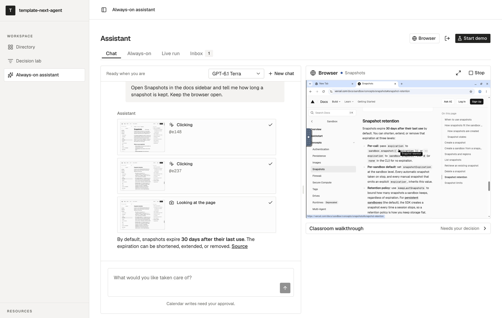
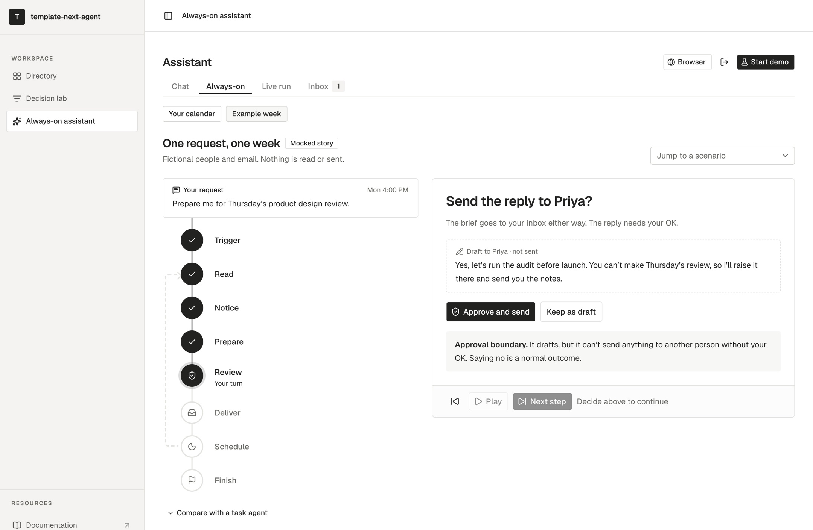
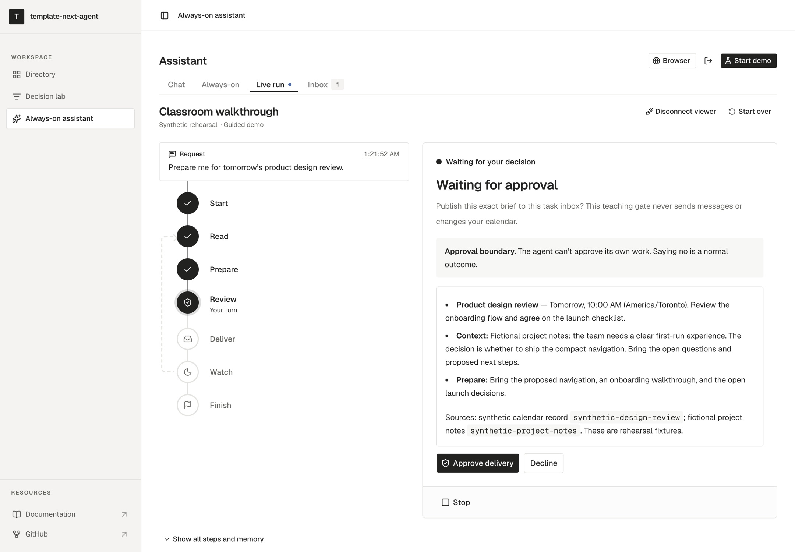
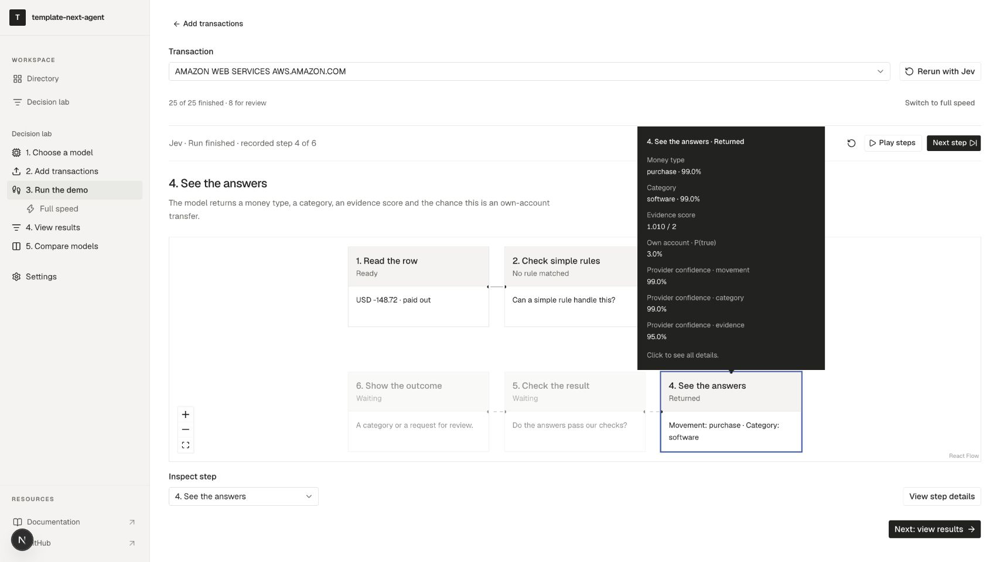

# template-next-agent

An open source Next.js starter for AI agents that keep working after you close the tab. It has two examples: an always-on personal assistant and a transaction decision lab.



## What's inside

**Always-on assistant** (`/assistant`)

- **Chat** with an [EVE](https://eve.dev/docs) agent. GPT-6.1 Terra is the default, and you can switch models.
- **Cloud browser.** Ask it to look something up and it drives Chrome in a [Vercel Sandbox](https://vercel.com/docs/vercel-sandbox) that you watch live beside the chat. Drag the divider to make it bigger, take control yourself, or start it without the agent. Tabs and sign-ins are saved between sessions.
- **Durable runs.** Tasks run on [Workflow SDK](https://useworkflow.dev): they sleep, wake on a schedule, wait for your approval, and survive restarts.
- **Calendar watch.** Connect Google Calendar and it calls out conflicts, cancellations, and changes on its own schedule.

| Always-on, explained with a mocked week | A live run, waiting for your approval |
| --- | --- |
|  |  |

**Decision lab** (`/transactions`)

Classify synthetic transactions or your own CSV with TypeSafe Jev. Step through each decision and compare models.



All screenshots use synthetic data.

## Quick start

You need Node.js 24 and [Bun](https://bun.sh).

```bash
git clone https://github.com/trancethehuman/template-next-agent.git
cd template-next-agent
bun install
cp .env.local.example .env.local
bun run dev
```

Open [http://localhost:3000](http://localhost:3000). Fill in `.env.local` for what you want to try:

| Feature | Variables |
| --- | --- |
| Any model call | `AI_GATEWAY_API_KEY` ([Vercel AI Gateway](https://vercel.com/docs/ai-gateway)) |
| Assistant sign-in | `AUTH_SECRET`, `AUTH_GOOGLE_ID`, `AUTH_GOOGLE_SECRET` ([setup](docs/AUTH.md)) |
| Cloud browser | `VERCEL_OIDC_TOKEN` from `vercel link` and `vercel env pull` |
| Public deployment | `DEMO_ACCESS_TOKEN` for the decision lab |

`.env.local.example` lists every option. Never commit `.env.local`.

## Commands

| Command | Purpose |
| --- | --- |
| `bun run dev` | Run the app, the agent, and local workflows. |
| `bun run test` | Run tests. |
| `bun run lint` and `bun run typecheck` | Check the code. |
| `bun run build` | Build for production. |

## Deploy

Import the repository into Vercel, enable AI Gateway, and add the variables above. Read [docs/SECURITY.md](docs/SECURITY.md) before opening it to other people.

## Learn more

- [Assistant guide](docs/ASSISTANT.md), [calendar setup](docs/ASSISTANT-CALENDAR.md), and [sign-in](docs/AUTH.md)
- [Decision lab walkthrough](docs/TEACHING.md) and [CSV format](docs/CSV.md)
- [Architecture](docs/ARCHITECTURE.md) and [security](docs/SECURITY.md)
- [Agent skills](skills/README.md) and [AGENTS.md](AGENTS.md) for coding agents
- [Contributing](docs/CONTRIBUTING.md)

Built with Next.js 16, React 19, AI SDK 7, EVE, Workflow SDK 5, Vercel Sandbox, agent-browser, shadcn/ui, and AI Elements.

## License

[AGPL-3.0](LICENSE). Third-party notices are in [THIRD_PARTY_NOTICES.md](THIRD_PARTY_NOTICES.md).
